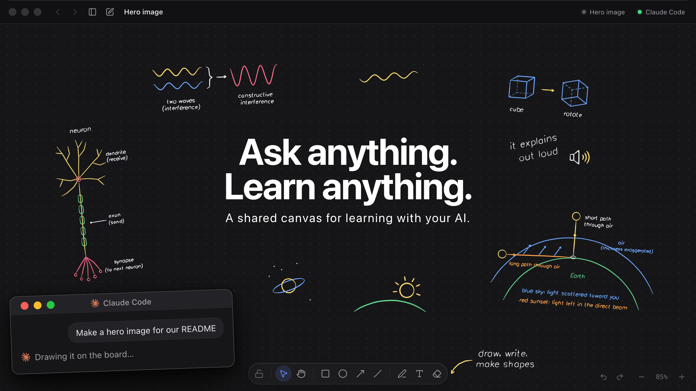

<p align="center">
  
</p>

<p align="center">
  <a href="https://github.com/Nordup/askaboard/releases/latest">Download for Mac</a> ·
  <a href="#connect-your-agent">Connect your agent</a> ·
  <a href="PRIVACY.md">Privacy</a>
</p>

<p align="center">Free and open source · macOS, Apple silicon and Intel</p>

Ask your AI agent a question, and it answers on a board. It draws, animates
and talks you through the idea, step by step. You write and draw on the same
board. The agent sees your work, checks it and builds on it.

Askaboard works with the agent you already use: Claude Code, Claude Desktop,
ChatGPT, Codex, Cursor or any MCP client. You bring your own subscription.
The app has no AI of its own and no account.

## Get started

1. [Download Askaboard](https://github.com/Nordup/askaboard/releases/latest)
   and move it to Applications.
2. Open it, then open a folder for your boards.
3. Click the agent pill at the top, then **Connect an agent**. The app
   installs the plugin for the agent you pick.
4. Restart your agent and ask it something. For example:

   > Why is the sky blue?

   > I cannot solve this one. Can you help me? Explain everything.

   > Q3-sales.xlsx has 2,000+ rows and I'm lost. Can you explain it simply?

Keep the app open while you work with the agent.

## Connect your agent

The app connects agents for you (step 3). To do it by hand:

| Agent | Setup |
| --- | --- |
| Claude Code | `claude plugin marketplace add Nordup/askaboard-plugins`, then `claude plugin install askaboard@askaboard` |
| ChatGPT and Codex | `codex plugin marketplace add Nordup/askaboard-plugins`, then `codex plugin add askaboard@askaboard` |
| Claude Desktop (Chat tab) | Download [`askaboard.mcpb`](https://github.com/Nordup/askaboard-plugins/tree/main/claude-extensions/askaboard/dist) and double-click it |
| Cursor | Add `Nordup/askaboard-plugins` as a plugin marketplace, then install **Askaboard** |
| Any MCP client | Server URL `http://127.0.0.1:47821/mcp`, or the stdio command `~/.askaboard/bin/askaboard mcp` |

All the details are in [`Nordup/askaboard-plugins`](https://github.com/Nordup/askaboard-plugins).

## Run from source

Askaboard is an Electron app in [`apps/desktop/`](apps/desktop/). It also runs on Linux
from source.

```sh
git clone https://github.com/Nordup/askaboard.git
cd askaboard/space
npm install
npm run dev
```

`npm run build` type-checks and bundles the app. See
[`apps/desktop/README.md`](apps/desktop/README.md) for what the app does and how it is
built.

## For agents and contributors

- [`CONTRIBUTING.md`](CONTRIBUTING.md) tells how to run, check and send a change.
- [`AGENTS.md`](AGENTS.md) is the start for an AI agent that works in this
  repo: where things live, how to run them, and the rules.
- [`docs/`](docs/README.md) has the design
  docs, the plans and every product decision with its reason.

| Folder | What it is |
| --- | --- |
| [`apps/desktop/`](apps/desktop/) | The app |
| [`apps/website/`](apps/website/) | The website |
| [`docs/`](docs/) | Design docs, plans, decisions and research |
| [`assets/brand/`](assets/brand/README.md) | Logo, icon and brand files |
| `web/`, `server/` | An earlier tutor app, paused |

## Feedback

Questions, ideas and bugs are welcome. Ask a question or share an idea
in [Discussions](https://github.com/Nordup/askaboard/discussions), report a
bug in [Issues](https://github.com/Nordup/askaboard/issues), or email
[nordup.ondr@gmail.com](mailto:nordup.ondr@gmail.com).

## License

[MIT](LICENSE). Askaboard uses open-source work by others; see
[`THIRD_PARTY_NOTICES.md`](THIRD_PARTY_NOTICES.md).
