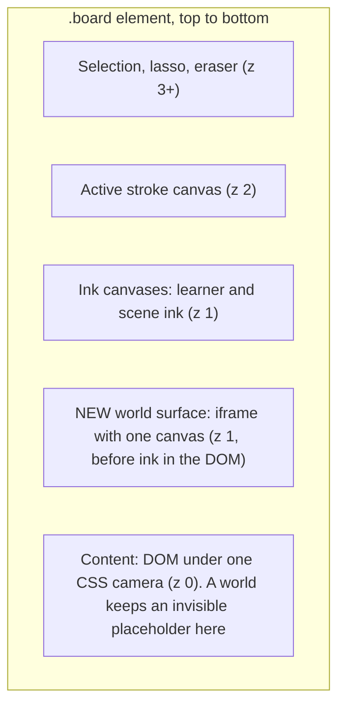
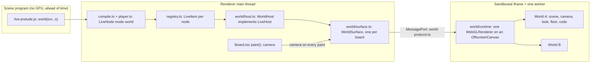
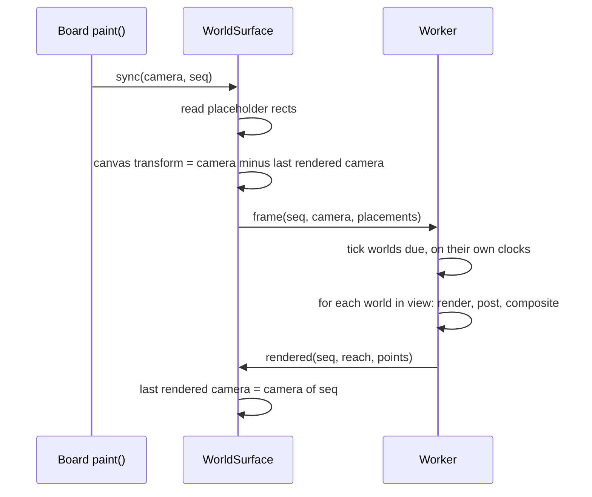
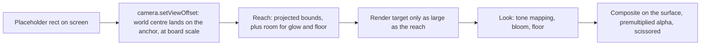
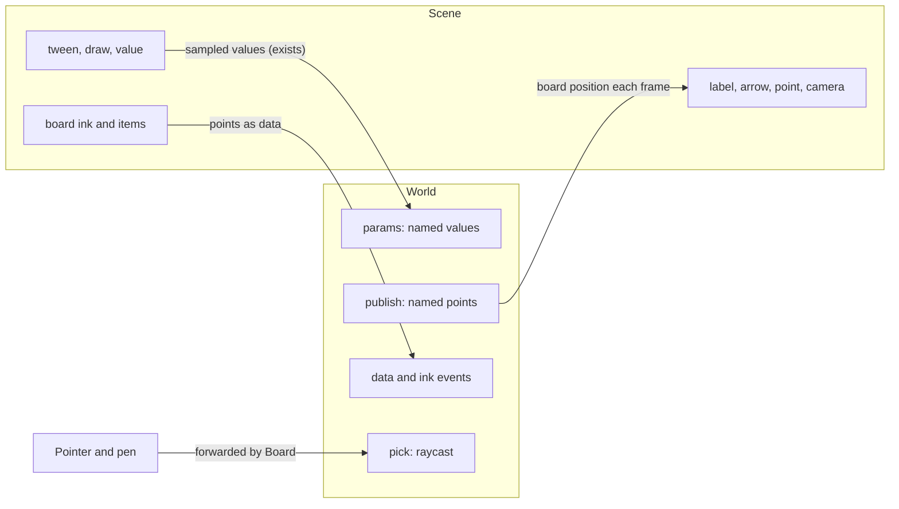
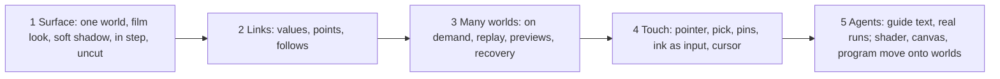

# One world: the architecture

> **Status (2026-10-31):** the build plan for
> [`one-world-design.md`](one-world-design.md), on branch `one-world`. Terms:
> a **world** is a live node with mode `world`. The **surface** is the one GPU
> canvas that draws all worlds. The contract between the page and the worker is
> `space/src/shared/world-protocol.ts`.

## 1. The layers

- The surface goes in the DOM after the content layer and before the ink canvas.
- Each world keeps its `.node-live` element in the content layer, as an invisible
  placeholder. So selection, moving, undo, the layout cache and playback overrides
  work with no change. The placeholder is the world's anchor and nominal size.

## 2. The components

| Module | Job | Reuses |
| --- | --- | --- |
| `live-prelude.js` | `world(src, o)`, the same `liveObject` path as `program` | All of it |
| `registry.ts` | The life cycle. `world` takes no slot, as `shader` does | `LiveItem` |
| `world/host.ts` | `WorldHost`: a thin `LiveHost` that forwards to the surface | `LiveHost` |
| `world/surface.ts` | The iframe, the port, placements, the CSS transform | `frame.html` boot of `program.ts` |
| `world/runtime` (worker) | The renderer, the frame loop, worlds, views, compositing | The clock rules of `runtime.ts` |
| `world/look` (worker) | Environment light, floor with soft shadow and reflection, bloom, tone mapping | `film.js` |

Each world runs in one realm with the others, as an async function with shadowed
`requestAnimationFrame`, `setTimeout`, `performance`, `Date` and a seeded `Math`.
All worlds share one `three` module, because they share one renderer.

## 3. One frame

- **In step with the board.** The transform and the board's own move happen in the
  same paint, so the picture never trails the ink. A new frame then replaces it.
- **Overscan.** The canvas is larger than the board by a margin on each side, so a
  pan shows no empty edge before the next frame.
- **On demand.** A frame renders only when a world runs, a value changes, or the
  camera changes. A world outside the view does not tick unless its scene plays.

## 4. One world's view: no frame, no stretch

- The world's camera keeps its own centre, so nothing stretches far from the
  board's centre. `setViewOffset` shifts where that centre lands on the surface.
- `o.size` is the nominal scale: the camera's view height at the target maps to
  that many board points. Anything outside it still draws.
- Reach comes from `Box3.setFromObject` a few times per second, and `world.reach()`
  can set it. It is padded, and it is never used as a visible edge.
- Render targets come from a pool, in steps of 64 pixels.

## 5. Links

- **Values in.** `wave.value("speed")` is a stage value bound to `params.speed`.
  `draw(wave.part("x"))` drives a reserved param. No new channel.
- **Points out.** `wave.point("x")` is a handle in the stage. The stage cannot know
  the place ahead of time, so an attached item stores `follows: {world, point,
  offset}` and the page moves it each frame. An arrow stores both ends, and the
  page rebuilds its path.
- **Hand in.** Board forwards the pointer. `pick` gives a named part and a local
  point. A mark stores that pin, and the world publishes it as a point, so a mark
  stays on the part as it turns.

## 6. Replay, preview and failure

- **Replay.** Seek back restarts the world, as it restarts a `program`: the code
  runs again with the same seed, and it catches up to the time.
- **Preview and screenshots.** `withStepHost` makes a `WorldHost` with a private
  headless surface. So stills use the same runtime. A still can be larger than the
  placeholder, so `LiveFrame` gains the offset of the picture.
- **Errors.** Each tick of a world runs in a try block. An error stops that world
  only and shows the usual note.
- **Endless loops.** If the worker stops answering, the surface ends it, starts a
  new one, adds all worlds again, and marks the world that was last ticking.
- **Context loss.** The surface restarts the same way.

## 7. Build slices

Rule for slice 5: `shader`, `canvas` and `program` stay until worlds replace them.
Old boards keep the old hosts until their items are converted.

## 8. Decisions in this build

- The film look and the floor with soft shadow are on by default, and every part
  can change (`look: "plain"`, `floor: false`). The founder called shadows "the
  best part".
- WebGL 2 first, because `film.js` is proven there.
- A world's code is a string in slice 1. Files come in slice 5.
