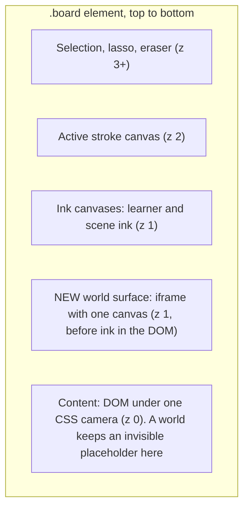
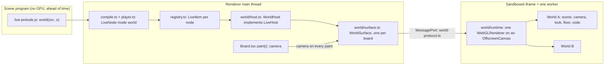
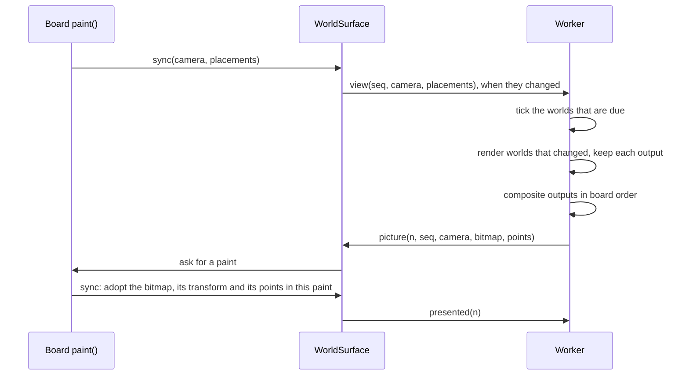
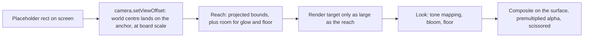
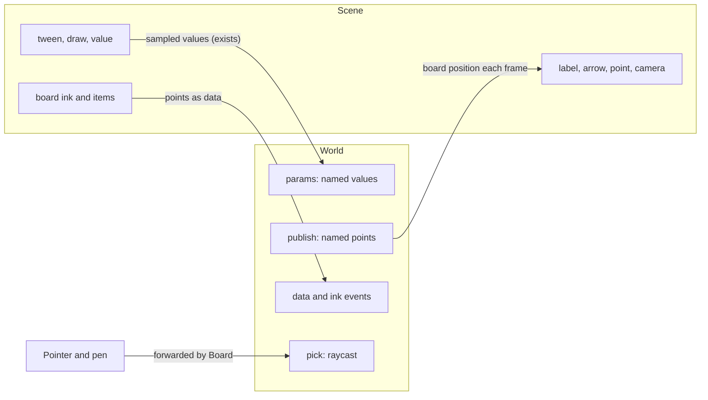
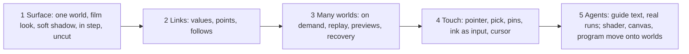

# One world: the architecture

> **Status (2026-10-31):** the build plan for
> [`one-world-design.md`](one-world-design.md), on branch `one-world`. Terms:
> a **world** is a live node with mode `world`. The **surface** is the one GPU
> canvas that draws all worlds. The contract between the page and the worker is
> `space/src/shared/world-protocol.ts`.

## 1. The layers

- The surface goes in the DOM after the content layer and before the ink canvas.
- Each world keeps its `.node-live` element in the content layer, as an invisible
  placeholder. So selection, moving, undo, the layout cache and playback overrides
  work with no change. The placeholder is the world's anchor and nominal size.

## 2. The components

| Module | Job | Reuses |
| --- | --- | --- |
| `live-prelude.js` | `world(src, o)`, the same `liveObject` path as `program` | All of it |
| `registry.ts` | The life cycle. `world` takes no slot, as `shader` does | `LiveItem` |
| `world/host.ts` | `WorldHost`: a thin `LiveHost` that forwards to the surface | `LiveHost` |
| `world/surface.ts` | The iframe, the port, placements, the CSS transform | `frame.html` boot of `program.ts` |
| `world/runtime` (worker) | The renderer, the frame loop, worlds, views, compositing | The clock rules of `runtime.ts` |
| `world/look` (worker) | Environment light, floor with soft shadow and reflection, bloom, tone mapping | `film.js` |

All worlds run in one realm and share one `three` module, because they share one
renderer. A world's code is an async function. Inside the realm, `performance`,
`Date`, `Math.random`, timers and `requestAnimationFrame` follow the world that is
running at that moment, so imported libraries such as `THREE.Clock` get that
world's time. After an `await` that link can be lost, so agents use `world.time`.

Each world pass sets its own renderer state and restores it, also after an error:
size, pixel ratio, exposure, tone mapping, shadows, render target and clearing.

## 3. One frame

A review by GPT-6.1 Sol found that a message cannot prove which pixels are on
screen. So the worker does not draw to a visible canvas. It sends each finished
picture to the page, and the page shows it in its own paint.

- **In step with the ink.** The picture, its CSS transform and its points change in
  the same main-thread paint as the ink. The transform is the current camera times
  the inverse of the picture's camera, for pan and for zoom.
- **One at a time.** The worker sends the next picture only after `presented`, so a
  slow page gets fewer pictures, not late ones.
- **Overscan.** The picture is larger than the board by a margin on each side, so a
  pan shows no empty edge before the next picture.
- **Tick and render are separate.** A camera move or a change in another world
  composites again. It does not advance a paused world.
- **On demand.** With nothing to tick and no change, nothing renders.

## 4. One world's view: no frame, no stretch

- The world's camera keeps its own centre, so nothing stretches far from the
  board's centre. `setViewOffset` shifts where that centre lands on the surface.
- `o.size` is the nominal scale: the camera's view height at the target maps to
  that many board points. Anything outside it still draws.
- `camera.aspect` is the nominal aspect. `setViewOffset(nominalW, nominalH, cropX,
  cropY, cropW, cropH)` takes a crop that can pass the nominal rect, so the size of
  a render target never changes the scale or the perspective.
- Reach comes from the world's bounds, sampled often and padded. It grows at once
  and shrinks slowly. `world.reach()` can set it, and `world.reach("full")` uses
  the whole visible surface for shaders that move vertices. It is never a visible
  edge. Culling uses reach, not the placeholder, so a world with an anchor outside
  the view still shows what reaches into the view.
- Tone mapping and colour output happen in the look's last pass. Bloom keeps real
  alpha. The last pass writes premultiplied colour, and compositing uses
  `ONE, ONE_MINUS_SRC_ALPHA`, with colour and alpha multiplied by world opacity.
- Render targets come from a pool, in steps of 64 pixels.

## 5. Links

- **Values in.** `wave.value("speed")` is a stage value bound to `params.speed`.
  `draw(wave.part("x"))` drives a reserved param. No new channel.
- **Points out.** `wave.point("x")` is a handle in the stage. The stage cannot know
  the place ahead of time, so an attached item stores `follows: {world, point,
  offset}` and the page moves it each frame. An arrow stores both ends, and the
  page rebuilds its path.
- **Hand in.** Board forwards the pointer. `pick` gives a named part and a local
  point. A mark stores that pin, and the world publishes it as a point, so a mark
  stays on the part as it turns.

## 6. Replay, preview and failure

- **Replay.** Seek back makes a new generation of the world: the code runs again
  with the same seed and catches up, unseen, while the old picture stays. Then the
  page shows the new generation and removes the old one. Results that depend on
  display intervals, the network or the learner's input keep the limits of
  `clock.ts`.
- **Preview and screenshots.** `withStepHost` makes a `WorldHost` with a private
  headless surface. So stills use the same runtime. A still can be larger than the
  placeholder, so `LiveFrame` gains the offset of the picture.
- **Errors.** Each tick of a world runs in a try block. An error stops that world
  only and shows the usual note.
- **Endless loops.** `pong` names the world that was running. If the worker stops
  answering, the surface ends it, starts a new one, adds all worlds again, and
  keeps the named world stopped with a note.
- **Context loss.** The surface restarts the same way.

## 7. Build slices

Rule for slice 5: `shader`, `canvas` and `program` stay until worlds replace them.
Old boards keep the old hosts until their items are converted.

## 8. Decisions in this build

- The film look and the floor with soft shadow are on by default, and every part
  can change (`look: "plain"`, `floor: false`). The founder called shadows "the
  best part".
- WebGL 2 first, because `film.js` is proven there.
- A world's code is a string in slice 1. Files come in slice 5.
