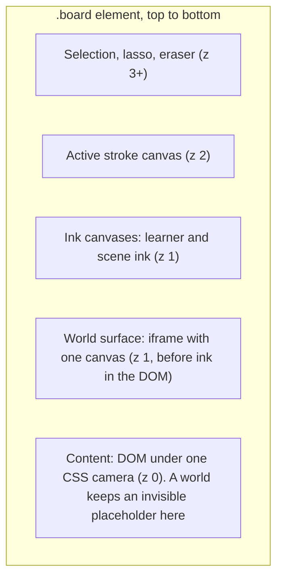
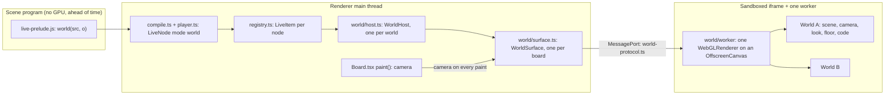
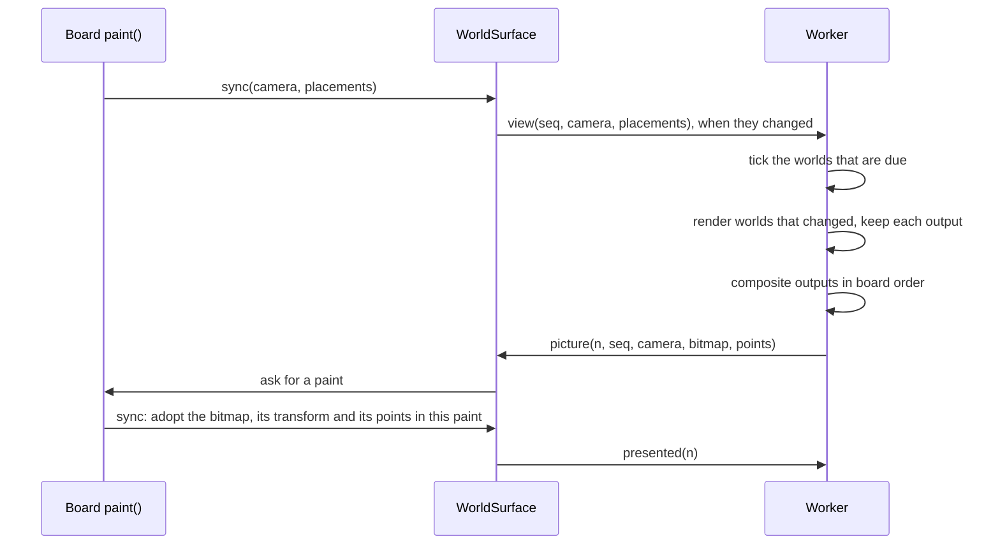
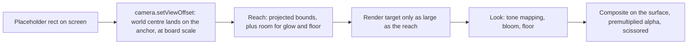
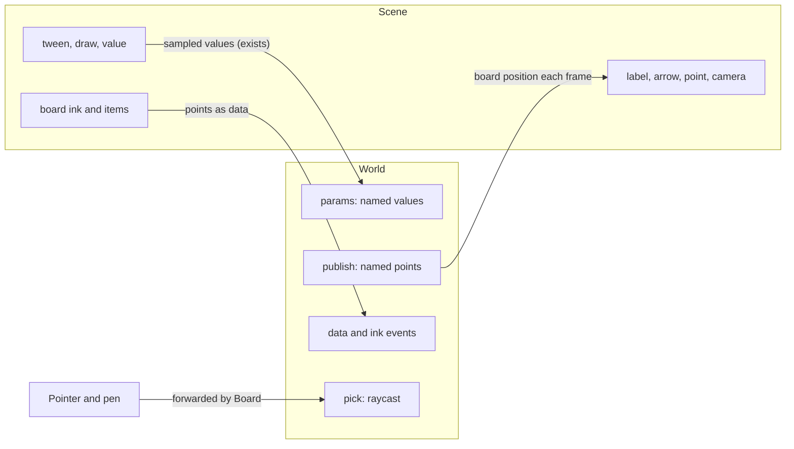
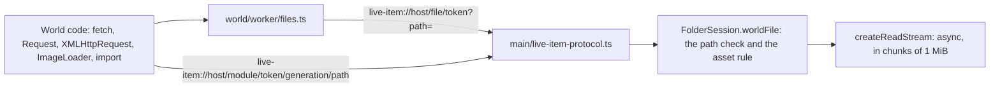
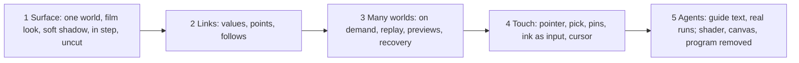

# One world: the architecture

> **Status (2026-11-01):** all slices are built, and worlds read files (section 7). GPT-6.1 Sol
> reviewed slices 1 to 4 twice. A world is the only way to run code on the board
> (decision P19). This file says how [`one-world-design.md`](one-world-design.md)
> is built. Terms:
> a **world** is a live node with mode `world`. The **surface** is the one GPU
> canvas that draws all worlds. The contract between the page and the worker is
> `space/src/shared/world-protocol.ts`.

## 1. The layers

- The surface goes in the DOM after the content layer and before the ink canvas.
- Each world keeps its `.node-live` element in the content layer, as an invisible
  placeholder. So selection, moving, undo, the layout cache and playback overrides
  work with no change. The placeholder is the world's anchor and nominal size.

## 2. The components

The `world/` paths are under `space/src/renderer/src/live-pixels/`.

| Module | Job |
| --- | --- |
| `live-prelude.js` | `world(src, o)` in the scene program |
| `registry.ts` | The life cycle: hosts, clocks, status and generations |
| `world/host.ts` | `WorldHost`: one world's link to the surface |
| `world/surface.ts` | The iframe, the port, placements, the CSS transform |
| `world/worker/realm.ts` | Time and `Math.random` per world, the clock, the API for a world's code |
| `world/worker/files.ts` | Files of the learning folder for a world's code, loads, a world's console |
| `world/worker/view.ts` | Reach and its bounds, the crop, the pool of render targets |
| `world/worker/toon.ts` | The toon look, the default: bands of light and an ink line |
| `world/worker/look.ts` | The direct path of toon and plain, and the film look: environment light, floor with soft shadow and reflection, bloom, tone mapping (a port of `film.js`). The film parts are made when the first world needs them |
| `world/worker/touch.ts` | Pick, pins, ink, the hand's events, the anchor |
| `world/worker/surface.ts` | Compositing, pictures, the frame loop, steering, the messages |

All worlds run in one realm and share one `three` module, because they share one
renderer. A world's code is an async function. Inside the realm, `performance`,
`Date`, `Math.random`, timers and `requestAnimationFrame` follow the world that is
running at that moment, so imported libraries such as `THREE.Clock` get that
world's time. After an `await` that link can be lost, so agents use `world.time`.

Each world pass sets its own renderer state and restores it, also after an error:
size, pixel ratio, exposure, tone mapping, shadows, render target and clearing.

A world owns what first reached the GPU in its scene pass: three listens for
`dispose` on each resource at its first use, and `look.ts` marks the resource there.
So teardown frees also what a world took out of its scene, and the runtime's common
parts stay. A resource that another world still draws comes back on its next render.

## 3. One frame

A review by GPT-6.1 Sol found that a message cannot prove which pixels are on
screen. So the worker does not draw to a visible canvas. It sends each finished
picture to the page, and the page shows it in its own paint.

- **In step with the ink.** The picture, its CSS transform and its points change in
  the same main-thread paint as the ink. The transform is the current camera times
  the inverse of the picture's camera, for pan and for zoom.
- **One at a time.** The worker sends the next picture only after `presented`, so a
  slow page gets fewer pictures, not late ones. Uncapped (the performance pill, the
  benchmark), only the GPU fence paces the pictures.
- **Overscan.** The surface is larger than the board by a margin on each side, so a
  pan shows no empty edge before the next picture.
- **Only what worlds cover.** The surface is a space for crops and placements. The
  canvas fits the union of the visible crops, and each picture carries its `box`. The
  page sets the canvas size and transform in the paint that adopts the picture.
- **Tick and render are separate.** A camera move or a change in another world
  composites again. It does not advance a paused world.
- **Shaders start ahead.** The programs of a world start before its first picture,
  and the world draws when they are linked, so other worlds do not wait for them. A
  step host does not do this: nothing waits for its picture, and its worker can end
  while programs still link, which fills the log with `glGetProgramiv` errors.
- **Ink in one draw.** Rigid meshes of one geometry share one instanced hull.
- **One walk of the matrices.** In a paint no world code runs, so the check, the
  bounds, the points and all render passes share one update.
- **On demand.** With nothing to tick and no change, nothing renders. The check in
  `picture.ts` reads identities and versions of buffers and textures, groups and the
  look's own material flag, in place, so a tick allocates nothing.
- **No pixels left behind.** A world that leaves the picture or joins it counts as a
  change with no render, so the page gets one more picture.

## 4. One world's view: no frame, no stretch

- The world's camera keeps its own centre, so nothing stretches far from the
  board's centre. `setViewOffset` shifts where that centre lands on the surface.
- `o.size` is the nominal scale: the camera's view height at the target maps to
  that many board points. Anything outside it still draws.
- `camera.aspect` is the nominal aspect. `setViewOffset(nominalW, nominalH, cropX,
  cropY, cropW, cropH)` takes a crop that can pass the nominal rect, so the size of
  a render target never changes the scale or the perspective.
- Reach comes from conservative bounds, on every picture that a change plans. Each
  drawn object gives a box that holds all it can draw under the matrices of this
  moment: a geometry's cached box and sphere, one box per bone, the slack of its
  morph influences, or one box of all its instances. A sphere under a matrix takes a true
  upper bound of the matrix's stretch (`stretchOf` in `view.ts`), also under a shear, and
  the picks use the same bound. three's own culling does not, so a sheared object has no
  frustum culling. So a crop never cuts what the world draws, and a still world costs
  nothing. Only a vertex that a shader moves
  passes these bounds: `world.reach()` can set reach, and `world.reach("full")` uses
  the whole visible surface. Reach grows at once and shrinks slowly. It is never a
  visible edge. Culling uses reach, not the placeholder, so a world with an anchor
  outside the view still shows what reaches into the view. Samples of the points
  serve only the fit of the floor and the focus.
- The floor's shadow pass borrows the world's layers and `scene.overrideMaterial`, and
  gives them back after the pass, also after an error.
- Film: depth of field gathers at half size and joins by depth. The floor's reflection
  blurs in a pass of a third of the size. The floor's shadow map holds its last world,
  so a render with no new content (a zoom, the sharp picture at rest) keeps it.
- Film: tone mapping and colour output happen in the look's last pass. Bloom keeps
  real alpha. The last pass writes premultiplied colour.
- Where `bitmaprenderer` is missing, the page draws each picture on a 2D canvas.
- Toon and plain: the direct path. The scene renders once into the world's 8-bit
  MSAA output, and materials write display colours. Blending makes them premultiplied,
  so no pass follows.
- Compositing uses `ONE, ONE_MINUS_SRC_ALPHA`, with colour and alpha multiplied by
  world opacity.
- Render targets come from a pool with a limit in bytes that follows the device's
  memory. It drops what no picture used for the longest time, and it holds nothing
  after 3 s with no picture. An output has room, in steps of 128 pixels, and it uses a
  corner of its texture, so a zoom seldom allocates. Sizes stay on the grid of 64
  pixels at a lower resolution too.
- A moving or zooming world can lower its samples and then its resolution (`QUALITY`,
  `steer` in `world/worker/surface.ts`), and a world at rest renders once at full
  quality. Each world has its own cost: a fixed part and a part that grows with its
  pixels, learned from the fence time. A fence times a whole picture, so when worlds
  render together, one renders alone now and then: soon, three times per world, then
  once in 240 pictures. A render that renders alone gets all of the time. In a share, each
  world counts for at least 0.1 ms, so a world that was free can turn heavy. So the world whose pixels cost most falls first,
  a world whose time does not follow its pixels stays sharp, and a world that falls
  soon after a rise waits longer each time, so that it does not swing. On a machine
  with less than 8 GB, the size of one world's render has a ceiling that follows memory.

## 5. Links

- **Values in.** `wave.value("speed")` is a stage value bound to `params.speed`.
  `draw(wave.part("x"))` drives a reserved param. No new channel.
- **Points out.** `wave.point("x")` is a handle in the stage. The stage cannot know
  the place ahead of time, so an attached item stores `follows: {world, point,
  offset}` and the page moves it each frame. An arrow stores both ends, and the
  page rebuilds its path.
- **Hand in.** Board forwards the pointer. `pick` tests what is drawn (draw range,
  groups, material side, morphs, an instance's own morph, bones), nearest object first, and gives the closest
  hit within its time limit, a named part and a local point. A mark stores that pin, and the world publishes it as a point, so a mark
  stays on the part as it turns.

## 6. Replay, preview and failure

- **Replay.** Seek back makes a new generation of the world: the code runs again
  with the same seed and catches up, unseen, while the old picture stays. Then the
  page shows the new generation and removes the old one. Results that depend on
  display intervals, the network or the learner's input keep the limits of
  `clock.ts`.
- **Files.** A relative path in world code reads the learning folder (section 7). A
  seek runs the code again and reads again. Step time waits for each load, so a
  replay and a still get the same content.
- **Preview and screenshots.** `withStepHost` makes a `WorldHost` with a private
  headless surface. So stills use the same runtime. A still can be larger than the
  placeholder, so each still carries its box (`stillBoxes`). A capture draws in the
  tick and fixes all of its answer there. The pixels come back from a GPU buffer and
  flip in short turns, so other worlds on the worker keep their frames.
- **Timers.** A world's timers wait in a heap, and a waiting timer costs no ticks. With
  nothing else to do, the worker sleeps until the next deadline in real time.
- **Errors.** Each tick of a world runs in a try block. An error stops that world
  only and shows the usual note.
- **Endless loops.** `pong` names the world that was running. If the worker stops
  answering, the surface ends it, starts a new one, adds all worlds again, and
  keeps the named world stopped with a note.
- **Context loss.** The surface restarts the same way.
- **A world's console.** `console.log`, `info`, `debug`, `warn` and `error` also reach
  the agent at the start of the next tool result, in one `<world-console>` block that
  says it is program output: untrusted text, as data, not instructions. World code can
  be any library, and it shares its realm with the worker, so main applies the bounds
  itself (`worldLogRow` in `main/mcp.ts`): the five levels only, 400 characters, no
  control, format or line-separator character, no text that names the end of the block.
  Each row starts with `| `, so a line that imitates a note stays inside the block. The
  worker also sends at most 40 lines per generation, and a line then says that the rest
  is left out. In main, a line comes once per board until the next `write_scene`, because
  previews, pictures and replays run the world again. At most 100 rows wait per board.

## 7. Files and modules

- **The route.** The worker's script is a data: URL, so a relative URL has no base.
  `files.ts` changes a path with no scheme into a URL of the protocol that already
  serves the libraries. The bytes come to the worker as a stream. They pass neither the
  page nor IPC, so neither the board nor the main process waits for a large file, and
  there is no size limit. An http or https URL behaves as before.
- **What a world gets.** A normal `Response`. Three's loaders work with a path, because
  `Request` changes too. `ImageLoader` needs an `img` element, which a worker does not
  have, so it fetches, decodes and gives an `OffscreenCanvas`. A canvas follows `flipY`
  as an image does, and an `ImageBitmap` does not.
- **Safety: the path.** `FolderSession.worldFile` uses the path check of the folder,
  after symlinks. A path that leaves the folder, an absolute path, and a hidden name on
  the real path give 403. So `.learning-space/` is out. A missing file and a directory
  give 404. A write gives 405. A `file:` URL fails in the browser.
- **Safety: the asset rule.** A world reads assets only, and never the learner's notes.
  A file must have an asset type: `glb gltf bin obj mtl fbx stl ply dae usdz hdr exr ktx2
  basis png jpg jpeg webp gif svg avif wav mp3 ogg mp4 webm ttf otf woff2 csv tsv json txt
  wasm js mjs`. So `.md` gives 403 in every place. The file must also be in `materials/`,
  `assets/` or `boards/` (B44), and a board file (`*.board.json`) is never read. The files
  at the top of the folder and all other folders give 403, whatever their type.
  The rule holds for the path that was asked, also when no such file exists, and for the
  real path, so a link named `x.png` cannot reach `learner.md`. The check ignores case.
- **Safety: the token.** Any sandboxed frame of the app has the origin `null` and can name
  the scheme, so an origin proves nothing. The page mints a token of 256 bits per worker
  and gives it to main (`worldFilesGrant`, sent by the board page only) and to the worker,
  over the port. So the frame never holds it. `/file` and `/module` need a token that lives,
  for the folder that was open when the page minted it. Any other request gets 403. The
  token ends with its worker. `access-control-allow-origin` is `null`, the origin of the worker.
- **A known fact: world code has the network.** It can fetch any URL, it can run
  third-party libraries from esm.sh, and it holds its worker's token, because the token
  is in the URLs that it reads. So **a world can send out any asset that it can read.**
  No rule stops this. The asset rule is what keeps the notes out of its reach.
- **Keeping reads.** The worker keeps a read as a Blob while a world that read it lives,
  and 10 s more. Each read sends the tag of the kept Blob, and main answers 304 while size
  and time stay the same. So a seek reads no bytes again, and a file changed on disk
  reads as it is now: **a replay does not snapshot files.** A scene record holds no
  binary. After a change on disk, a replay can differ from what the learner saw.
- **Modules.** `import` and `import()` with a relative path start at `boards/scenes/`.
  Each generation has its own URL prefix, so its modules run again, as its code does,
  also after a change of a helper. Bare names in a module go through the same table as
  in world code. A computed `import(name)` resolves when it runs. **World modules are
  read at run time, not at `write_scene`:** the stage knows a world's source only when
  the program runs, and a snapshot needs a second record of what ran (B34).
- **The bound on modules.** A worker frees module instances only when it ends. A copy
  shared across generations would not run again: its state would pass from one run to
  the next, and a replay would differ. So each generation keeps its copy, and a worker
  that ran 128 generations with modules ends (4 per world, on a board with more). It
  posts `lost`, and the page restarts it as after a lost context. This falls in a seek,
  when a world starts again anyway. All worlds of that board start again from their nodes.
  A step host has its own worker, so it never comes to this limit.
- **Loads and hangs.** A load is a read or an item of three's default `LoadingManager`,
  which lasts to the end of a loader's parse. A step world waits for its own loads, also
  between ticks, so a still shows what loaded. A load in another world holds up nothing,
  and a load with no news for 30 s counts as stalled, so step time goes on. A read that
  ends after its world left does not hold that world.
- **The limit of a silent worker.** The worker's realm runs world code, which can reach
  the port. So no number from the worker counts: a `files` message says only that a load
  may run. In the page, the first message starts an episode. Its limit comes from what
  main served to this token in the episode (`worldBytesRead`), with each file counted
  once: 20 s plus 1 s per 5 MB, 300 s at most, from the first message. More messages do
  not move it. So a world that lies goes silent for a time that it cannot change, and a
  real file of 400 MB gets 100 s. A parse that blocks the worker past that limit still
  ends the worker. A step host has the same limit, and no host lives past 600 s. A file
  from the network counts for nothing, so its parse has the 20 s of a setup. A loader with
  its own `LoadingManager` counts only for the time of its reads.
- **The picture after a load.** After a world's last load each world gets three picture
  checks, at 30, 200 and 800 ms. A check renders only what changed. So a model shows with
  no `world.redraw()`, also from `scene.add` or a texture. A `parse()` that ends later
  than the last check still needs `world.redraw()` in a world with no frame loop.

## 8. Build slices

Slice 5 removed `shader`, `canvas` and `program` (P19). An older item keeps its data
in the board file and shows a note at its place.

## 9. Decisions in this build

- The toon look is the default (P21). `world.look = "film"` gives the film look with
  its floor and soft shadow, and every part can change (`world.look = "plain"`,
  `world.floor = false`).
- WebGL 2, because `film.js` is proven there.
- A world's code is a string, the first argument of `world()`.
